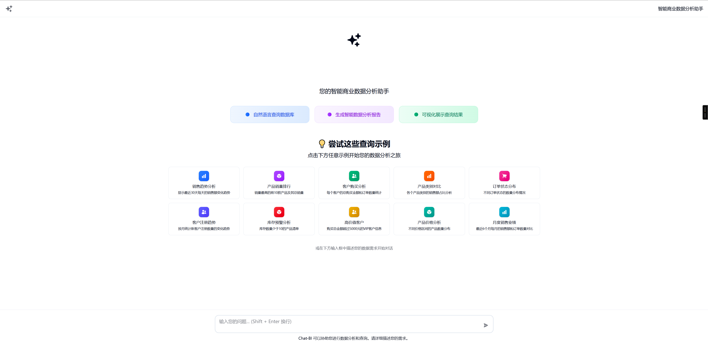
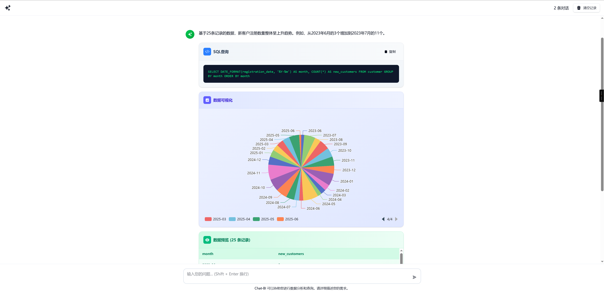
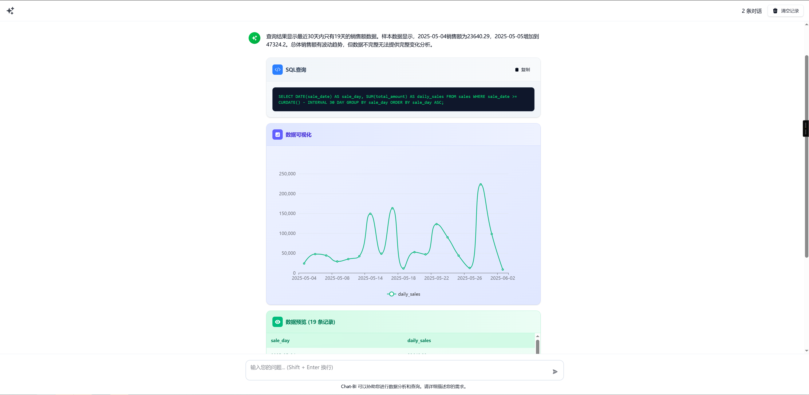

# Chat-BI

[English Version](README.md)

Chat-BI 是一个自然语言数据分析助手，可以把业务问题转换为 SQL，执行查询，并返回结构化答案、图表和数据表。

## 核心特点

- 自然语言转 SQL，结合 schema 理解和可复用 SQL 模板
- 基于 FastAPI 的后端，集成 MySQL 与 Milvus
- 支持可配置的 LLM 与 Embedding Provider
- 现代化 React 前端，支持会话历史、国际化、明暗主题切换
- 本地开发优先，Python 使用 `uv`，前端使用 `pnpm`

## 架构概览

```text
前端 (React + TypeScript + Vite)
    ->
后端 API (FastAPI)
    ->
业务库 (MySQL) + 系统库 (MySQL)
    ->
向量库 (Milvus)
    ->
LLM / Embedding Provider (OpenAI, DeepSeek, Ollama)
```

## 工作流程

1. 用户用自然语言提出问题。
2. 系统先对问题做向量化，并检索相似 SQL 模板。
3. 如果没有合适模板，后端会结合 schema 上下文生成 SQL。
4. 查询会在业务数据库中执行，并附带基础安全限制。
5. 最终返回自然语言答案，以及图表 / 表格数据。
6. 新生成的模板可以被保存，用于后续更精准匹配。

## 技术栈

- 后端：Python 3.10+、FastAPI、SQLAlchemy、PyMilvus、OpenAI SDK
- 前端：React 19、TypeScript、Tailwind CSS、Zustand、ECharts、Vite
- 存储：MySQL、Milvus
- 包管理：`uv`（Python）、`pnpm`（前端）

## 截图

**首页**



**饼图**



**折线图**



## 配置方式

后端当前采用 **YAML 优先** 的配置方式。

1. 复制示例配置：

```bash
cp config.example.yaml config.yaml
```

2. 编辑 `config.yaml`：

```yaml
debug: false

database:
  host: localhost
  port: 3306
  user: root
  password: admin123456
  name: chat_bi
  sys_name: chat_bi_system

milvus:
  host: localhost
  port: 19530

llm:
  provider: openai
  model: gpt-4.1
  api_key: your_api_key_here
  base_url: ""

embedding:
  provider: openai
  model: text-embedding-3-small
  dim: 1536
  api_key: ""
  api_url: ""
```

如有需要，环境变量仍可覆盖 YAML 中的值。

## 快速开始

### 方式 A：本地开发

#### 启动后端

```bash
uv sync
uv run python main.py
```

后端 API 默认运行在 `http://localhost:13000`。

#### 启动前端

```bash
cd web
pnpm install
pnpm dev
```

前端默认运行在 `http://localhost:5173`。

### 方式 B：只启动本地基础设施

如果你希望 MySQL + Milvus 运行在 Docker 中，而前后端进程运行在宿主机上：

```bash
cd deploy
docker-compose -f docker-compose-base.yaml up -d
```

会启动以下基础服务：

- MySQL：`localhost:3306`
- Milvus：`localhost:19530`
- Attu：`http://localhost:19000`

### 方式 C：完整 Docker 部署

仓库也提供了完整部署命令：

```bash
make build
make up
```

说明：

- Compose 文件位于 `deploy/` 目录。
- 当前后端运行方式是 YAML 优先，但现有部署编排在某些场景下仍可能依赖环境变量方式。
- 对于日常开发，推荐优先使用 `config.yaml` 的本地开发模式。

## 常用地址

- 前端：`http://localhost:5173`
- 后端 API 文档：`http://localhost:13000/docs`
- Milvus Attu：`http://localhost:19000`

## 测试问题示例

- 现在可以查询什么？
- 显示最近 30 天每天的销售额趋势
- 销量最高的前 10 个产品是什么？
- 各产品类别销售额占比是多少？
- 库存低于 10 的产品有哪些？

## 测试数据

```bash
python test/generate_test_data.py
python test/run_test_data.py
```

## 贡献

欢迎提交 Issue 和 Pull Request。

- 作者：[sumingcheng](https://github.com/sumingcheng)
- 仓库地址：https://github.com/sumingcheng/chat-bi
